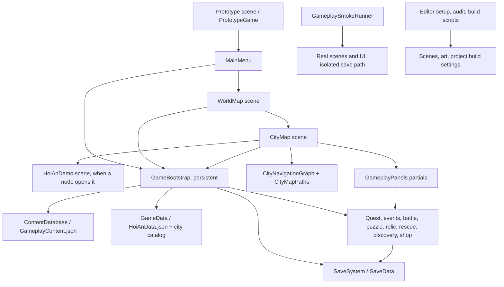

# LightBetweenCultures codebase map

## Scope and source of truth

This map was written from the runtime scripts, enabled build scenes, resource JSON files, validation runners, and Editor tooling in this project. It describes source wiring; a runner or build script is not evidence that a device or release build passed.

The game source is primarily under `Assets/_Game/Scripts`. Runtime JSON is under `Assets/_Game/Resources`; Unity addresses a resource by its `Resources.Load` key, without the `.json` extension. Keep those paths stable unless every runtime and Editor consumer is traced.

## High-level architecture

Build settings list `Prototype.unity`, `WorldMap.unity`, `CityMap.unity`, `HoiAnDemo.unity`, and `Assets/_Game/Scenes/Template/SampleScene.unity`, in that order. `PrototypeGame` is the compatibility component in the first scene; its `Start` ensures the persistent bootstrap and adds `MainMenu` if needed. `GameBootstrap` is a `DontDestroyOnLoad` composition root. Managers are ordinary C# objects owned by it; scene controllers and UI call those objects.

## Modules and responsibilities

| Module | Main responsibility | Representative source |
| --- | --- | --- |
| Core | Runtime composition, city data, derived world flags and scene transitions | `Core/GameBootstrap.cs`, `Core/GameData.cs`, `Core/WorldState.cs`, `Core/SceneTransition.cs` |
| Persistence | Existing save schema, normalization/recovery and atomic disk writes | `Persistence/SaveSystem.cs` |
| Gameplay | Quest/inventory/shop rules and content-driven node events, encounters, puzzles, rescues and relics | `Gameplay/Quests/QuestManager.cs`, `Gameplay/Inventory.cs`, `Gameplay/JourneyShop.cs`, `Gameplay/Content/*.cs` |
| Maps | World/city screens, navigation model, route rendering, discovery, markers and movement | `Maps/WorldMap.cs`, `Maps/CityNavigation.cs`, `CityMap*.cs`, `CityMapPaths.cs`, `MapDiscoveryManager.cs`, `NodeMarkerResolver.cs` |
| UI | Runtime Canvas construction and feature panels; UI sends intent to managers and renders their results | `UI/UIController.cs`, `MobileUI.cs`, `GameplayPanels*.cs`, `InventoryPanel.cs` |
| HoiAn scene | Separate Hoi An walk-and-interact scene and its local components | `Gameplay/HoiAn/HoiAnGameplay.cs`, `Gameplay/HoiAn/HoiAnPlayerController.cs`, `Gameplay/HoiAn/InteractionSystem.cs` |
| Entry | Compatibility component that starts the menu in the existing Prototype scene | `Gameplay/Entry/PrototypeGame.cs` |
| Validation | Opt-in Editor/Development Player integration journeys that inject input into real scenes and use a save override | `Validation/GameplaySmokeRunner*.cs`, `SliceSmokeRunner.cs`, `AndroidQaBridge.cs` |
| Editor | Explicit setup/import, asset audit, and platform build entry points | `Editor/*Setup.cs`, `SliceValidation.cs`, `Phase5Setup.cs`, `AndroidApkBuild.cs`, `AndroidQaBuild.cs`, `Phase7Audit.cs` |

## Important runtime types and dependencies

### Core and state

- `GameBootstrap` creates and connects `ContentDatabase`, `GameData`, `SaveData`, `Inventory`, `WorldState`, `QuestManager`, `MapDiscoveryManager`, `BattleManager`, `PuzzleManager`, `NodeEventManager`, `RelicCollection`, `JourneyShop`, `CatRescueManager`, and `SceneTransition`.
- `GameData.Load` combines `Content/GameplayContent.json` city definitions with legacy `HoiAnData.json` compatibility data. Hoi An keeps its existing node order/positions; city edges and navigation are sourced from the runtime city catalog. `FindRoute` delegates to `CityNavigationGraph.Plan`.
- `QuestManager`, `Inventory`, `WorldState`, and feature managers operate on the bootstrap's `SaveData`. `WorldState` derives `seoul.relays_ready` from the three relay flags.
- `SaveSystem` is the file persistence boundary. Validation sets `SaveSystem.OverridePath` so smoke journeys do not use the player's default file.

### Content and map services

- `ContentDatabase` is a cached deserialization of `Content/GameplayContent.json`; it provides cities, events, items, enemies, quests, puzzles, resonances, and check-ins.
- `CityNavigationGraph` reads `Content/CityNavigation.json`. `MapDiscoveryManager` decides whether a node is hidden, preview-only, or revealed. `CityMap`, routing, and marker presentation consult game state rather than granting progress themselves.
- `NodeEventManager` builds available node choices and executes them. It delegates encounter resolution to `EncounterManager`, and exposes the Seoul finale implemented in its `FinalConnection` partial.
- `NodeMarkerResolver` is presentation policy. Its source comment and implementation show it reads event/quest/check-in state; it does not accept quests, grant items, resolve events, open gates, or write saves.
- `CityMapPaths` draws one batched route mesh from navigation edges. `CityRouteGeometry` supplies endpoints, path samples, distances, and covered-walkway geometry; `CityMap.Move` animates Lumi along planned navigation legs.

### UI and validation

- `CityMap` constructs the city canvas and node targets, then constructs `GameplayPanels` with close/refresh callbacks. `GameplayPanels` is partial across feature files but remains one runtime class with shared fields and private helpers; its split is by feature, not by separate services.
- `UIController` owns Canvas/safe-area basics. `MobileUI` composes common button, frame, icon, and skin behavior. Feature panels invoke manager methods and render their results.
- `GameplaySmokeRunner` is guarded by `UNITY_EDITOR || DEVELOPMENT_BUILD` and installs only when an explicit command-line selector is passed. It injects mouse/touch/keyboard input, redirects the save to its output folder, and writes results/captures there.
- Editor setup scripts can modify assets or scenes; build/audit entry points are separate. Do not run a setup generator as if it were a read-only test. For example, `Phase6Setup.ApplyVisualFixesAndBuild` edits texture importer settings and then builds.

## UI and validation source guide

### Reading the panel partials

All paths below are under `Assets/_Game/Scripts/UI`. These files share the `GameplayPanels` type; helper MonoBehaviours declared alongside a panel are also compiled normally.

| File | Responsibility visible in its methods |
| --- | --- |
| `GameplayPanels.cs` | Common sheet lifecycle, node choices, event execution, receipts, battle and puzzle panels. |
| `GameplayPanels.StableUI.cs` | Updates existing dialogue, battle, puzzle and shop controls in place. |
| `GameplayPanels.HotfixRewards.cs` | `ActualRewardWatch` measures item/coin deltas for receipts; called from battle, puzzle, activity and shop UI. |
| `GameplayPanels.CatRescue.cs` | Rescue hub, collection, challenge modes, maze, facts and final rescue views. |
| `GameplayPanels.Relics.cs` | Fragment/source, assembly, trial, collection, detail and photo views. |
| `GameplayPanels.CulturalTrials.cs` | Relic trial controls including Hanji, survey and prism stream interactions. |
| `GameplayPanels.FinalConnection.cs` | Ceremony confirmation, scene-bound animation and ending/credits pages. |
| `GameplayPanels.StoryActivities.cs` | Story activity boards and interaction components. |
| `GameplayPanels.CheckIns.cs` | Check-in, scenery and photo journal views. |
| `GameplayPanels.JourneyShop.cs` | Journey shop rows, confirmation and purchase callbacks. |
| `GameplayPanels.Guidance.cs` | Guidance panel. |
| `GameplayPanels.PlayerGuide.cs` | Player guide, first-adventure introduction and motion preferences. |
| `GameplayPanels.ContextHelp.cs` | Context help and activity progress/help display. |
| `GameplayPanels.GameFeel.cs` | Battle response presentation and effects. |
| `GameplayPanels.Leisure.cs` | Leisure views and scene presentation. |
| `GameplayPanels.LeisureInput.cs` | Gesture ownership, pointer/drag handling and release interactions. |
| `GameplayPanels.LeisurePilots.cs` | Pilot leisure scene presentation and motion helpers. |

### Validation source groups

All paths below are under `Assets/_Game/Scripts/Validation`. The central `GameplaySmokeRunner.Run` selects journeys by command-line flags; inspect that dispatcher before choosing a group. A historical test can encode an older feature contract: the S21 code in `GameplaySmokeRunner.FullStory.cs` requests `ending` directly after the boss, while the current runtime requires canonical ceremony completion before that action is available. This is a confirmed coverage mismatch, not a runtime failure reproduced in this refactor.

| Area | Existing runner files |
| --- | --- |
| Story, chapter progression and restart | `GameplaySmokeRunner.cs`, `.Chapters.cs`, `.CrossCity.cs`, `.DaLat.cs`, `.FullStory.cs` |
| Route/discovery, map input and return | `.ApprovedRoutes.cs`, `.Terrain.cs`, `.MapReturn.cs`, `.MapClarity.cs`, `.AndroidTouch.cs`, `.OwnerRoutesB.cs` |
| NPC, portraits and interactions | `.MapNpcMarkers.cs`, `.NpcPlacement.cs`, `.NpcStanding.cs`, `.ThreeNpc.cs`, `.Portraits.cs`, `.H3.cs`, `.H3Tap.cs` |
| Rescue, relics, check-in and lighting | `.CatRescue.cs`, `.Relics.cs`, `.CheckIns.cs`, `.Lighting.cs` |
| UI, shop, audio and presentation | `.JourneyShop.cs`, `.NodePanels.cs`, `.UIPolish.cs`, `.GelButtons.cs`, `.Appearance.cs`, `.Music.cs`, `.SoftSfx.cs`, `.RenderQuality.cs` |
| Leisure and feedback | `.StoryLeisure.cs`, `.LeisurePilot.cs`, `.LeisureFull.cs`, `.LeisureVisuals.cs`, `.GameFeel.cs`, `.PlayerExperience.cs`, `.HueSnap.cs` |
| Historical milestones and acceptance journeys | `.Phase4.cs`, `.Phase4Integration.cs`, `.Phase5.cs`, `.Phase6.cs`, `.Phase7.cs`, `.Contest.cs`, `.Credits.cs`, `.ReleaseCandidate.cs`, `.FinalUX.cs`, `.FinalPolish.cs`, `.PcGameplay.cs`, `.CasualRuntime.cs`, `.OwnerConfusion.cs` |

`SliceSmokeRunner.cs` is a separate opt-in harness. `AndroidQaBridge.cs` provides Android QA telemetry under its compile/installation guards. None of these names are a reason to delete a file.

The bounded Editor-only `Editor/RouteGeometryRefactorChecks.cs` added for this refactor runs without `GameBootstrap` or a scene and compares legacy route geometry/travel results for all node pairs in each city. Its output flag is documented in `REFACTOR_REPORT.md`.

## Runtime data files

| Resource or file | Runtime/editor use verified in scripts |
| --- | --- |
| `Assets/_Game/Resources/Content/HoiAnData.json` (`Resources.Load("HoiAnData")`) | Legacy Hoi An node/order/quest compatibility input in `GameData.Load`; `HoiAnMapLayoutWindow` edits this file. |
| `Resources/Content/GameplayContent.json` (`Content/GameplayContent`) | Main runtime catalog loaded by `ContentDatabase.Load`. |
| `Resources/Content/CityNavigation.json` (`Content/CityNavigation`) | Runtime navigation graphs loaded by `CityNavigationCatalog.Load`. |
| `Resources/Content/AdventurePresentation.json` (`Content/AdventurePresentation`) | Marker policy and map/presentation definitions; read by `NodeMarkerResolver` and map quest-reaction code, and by Editor presentation setup. |
| `Resources/Content/CatRescue.json` (`Content/CatRescue`) | Rescue chapters, supplies, challenge modes, and rescue nodes loaded by `CatRescueCatalog.Load`. |
| `Resources/Content/CulturalRelics.json` (`Content/CulturalRelics`) | Relic, fragment, and story records loaded by `RelicCollection`. |
| `Resources/Content/StoryInteractions.json` (`Content/StoryInteractions`) | Activity presentation read by `ActivityPresentation.Load`. |
| `Resources/Content/LeisureActivities.json` (`Content/LeisureActivities`) | Leisure presentation read by `LeisurePresentation.Load`. |
| `Resources/Content/HoiAnLighting.json` (`Content/HoiAnLighting`) | Hoi An lighting presentation in `CityMap.RelicLight`. |
| `Resources/Content/FinalConnectionPresentation.json` (`Content/FinalConnectionPresentation`) | Board/art presentation for finale UI in `GameplayPanels.FinalConnection`. |
| `Resources/Content/SourceCities/*.json` | Present as per-city source JSON. Runtime script search for direct `Resources.Load` calls did not find a `SourceCities` load; runtime city records used by `GameData` come from `GameplayContent.json`. Other authoring/provenance roles should be confirmed before changing them. |

These content keys remain stable. Image keys moved during the verified layout migration: `LeisureProps/...` is now `Art/Leisure/...`, `CatRescue/RescueCats` is now `Art/Characters/Cats/RescueCats`, and `CatRescue/DaLatStation` is now `Art/Maps/DaLat/DaLatStation`. C# and JSON consumers were updated together; each image has one physical copy. ScriptableObject catalogs remain directly under `Resources`, while image files loaded by key live under `Resources/Art`. See [CLEANUP_REPORT.md](CLEANUP_REPORT.md) and [FINAL_TREE.md](FINAL_TREE.md).

## Main runtime flows

### 1. Startup and continue

1. Unity enters `Prototype.unity`; `PrototypeGame.Start` calls `GameBootstrap.Ensure` and attaches `MainMenu` if absent.
2. `GameBootstrap.Awake` loads the shared content catalog and initial city data, calls `Reload`, persists the bootstrap object across scene loads, then attaches `SceneTransition`.
3. `Reload` loads and normalizes the save, validates its city/node, constructs state/services, imports legacy Hoi An tutorial flags where applicable, and refreshes map discovery.
4. `MainMenu.Start` chooses the continue copy based on existing save progress. Continue opens the world map; a fresh main-story start opens the city map or first-adventure UI.

### 2. Travel between cities

1. `SceneTransition.OpenWorld` records the return scene and selected destination; its load coroutine persists before loading `WorldMap`.
2. `WorldMap.Select` renders the city card and enables entry only when `GameBootstrap.IsCityUnlocked` and `runtimeReady` both allow it.
3. The Enter button calls `GameBootstrap.EnterCity`, which persists current-city progress, loads the target `GameData`, restores that city's saved node/visited list, then requests `CityMap`.
4. On return, `WorldMap` uses its saved return scene. `GameBootstrap` remains alive across both loads.

### 3. City movement and discovery

1. A node button or map hit target calls `CityMap.TryMove`.
2. `MapDiscoveryManager` and `GameData.FindRoute` gate visibility and plan a route over `CityNavigationGraph`; edge requirements are checked again as movement advances.
3. `CityMap.Move` animates each leg using `CityRouteGeometry`, updates the canonical saved node and visited history at arrivals, calls `NodeEventManager.OnArrive`, persists, and opens an interaction if that arrival requires one.
4. `CityMapPaths` renders the route separately from the movement controller. Graph junctions are transient navigation vertices; only canonical city nodes are written to the save.

### 4. Dialogue and quests

1. `CityMap.Interact` asks `NodeEventManager.BuildOptions` for the current node's speaker, text, requirements, and enabled actions.
2. `GameplayPanels.ShowEvent` turns that view into a panel. Clicking an option calls `GameplayPanels.Execute`, which invokes `NodeEventManager.Execute`.
3. The event manager checks the choice again, then calls `QuestManager`, `Inventory`, `PuzzleManager`, `EncounterManager`, or other services as appropriate. The owning manager mutates state and persists through `GameBootstrap.Persist`.
4. UI callbacks refresh the map/panel after the result. The UI is not the authority for quest eligibility.

### 5. Combat and encounter rewards

1. An available encounter option causes the panel to open `GameplayPanels.ShowBattle`; `BattleManager.Start` validates current city/node and event eligibility and loads the enemy definition.
2. Battle buttons call `BattleManager.Act`. Victory or repair resolution passes to `EncounterManager.Resolve`.
3. `EncounterManager` records the encounter/choice, applies flags, merges event and enemy reward quantities by item ID, grants through the one-time inventory ledger, updates coins, and persists.

### 6. Cat rescue

1. `CatRescueCatalog.Load` reads the rescue chapters. `CatRescueManager.Current` and `Next` choose the active city's chapter and next incomplete challenge.
2. `CityMap`/`GameplayPanels.CatRescue` display supplies and challenge-specific controls. Manager actions (`Start`, `Collect`, `Match`, `Find`, `Choose`, `Walk`, `Complete`, `Rescue`) check city/node/order and challenge state.
3. `Commit` snapshots the serialized save, applies one action, persists, and restores the in-memory snapshot if persistence fails. Rescue reward coins are protected by the existing reward ledger.

### 7. Relic collection and restoration

1. `RelicCollection` loads the shared relic catalog and checks source proof/location, fragment ownership, assembly requirements, and restoration eligibility.
2. `BeginSource`, `BeginAssembly`, or `BeginPhoto` creates an ephemeral `RelicActivity`; drag/rotate/mirror interactions update this session only.
3. Explicit `Claim`, `Assemble`, `Restore`, or `RecordPhoto` methods validate the session and eligibility before writing flags/ledger through a persistence transaction. Closing a panel alone does not grant proof.
4. `GameplayPanels.Relics`, `GameplayPanels.StoryActivities`, and `GameplayPanels.FinalConnection` present these flows. The endgame reads relic flags through `RelicCollection`; it does not replace the save mechanism.

### 8. Save and load

1. `SaveSystem.PathName` selects `Application.persistentDataPath/hoi-an-v1.json`, unless a validation override is set.
2. `SaveSystem.Load` tries the main file, `.bak`, then `.tmp`; it accepts save versions 1 and 2, normalizes optional additive collections in memory, and retains inventory/quest data if a saved node is invalid.
3. `SaveSystem.Write` serializes the existing `SaveData` shape to a temporary file, preserves a backup of the current main file, then replaces/moves the temporary file into place. Android uses the project's `rename` wrapper.
4. `GameBootstrap.Persist` refreshes derived flags/discovery and city progress before delegating to `SaveSystem.Write`.

The current `SaveData.version` is 2. No save fields, version, path, or serialization behavior were changed by this refactor.

### 9. Seoul S21 ending

1. `NodeEventManager.FinalConnection.AtFinal` requires the active `CityMap`, Seoul, visible node `S21`, and saved current node S21.
2. `FinalConnectionReady` requires the Seoul final encounter resolved, all six listed relic IDs restored, and `RelicCollection.AllRestored`.
3. The final node's event is dispatched by the same `NodeEventManager`; its options include report, ceremony, replay, collection, or defer according to state. The report action can complete `SQ03` independently of the ceremony.
4. `ceremony_confirm` starts a scene-bound 24-second presentation. The UI may call the explicit skip action. Finish/skip commits `game.canonical_ending_completed.v1` through `GameBootstrap.Persist`, then opens the ending panel.
5. `GameplayPanels.FinalConnection` displays presentation pages/credits and acknowledges them through the event manager; `game.ending_seen` is a separate acknowledgement flag. The code keeps finale presentation and save ownership in the existing event/save services.

## Legacy, hotfix, phase, and prototype files

Names alone do not establish that a script is unused. `PrototypeGame` is referenced by the enabled first scene and leads into `MainMenu`. `PrototypeSetup` can create that scene. Phase setup classes are referenced by Editor workflows (`Phase6Setup` and `Phase7BotSetup` call `Phase5Setup.Build`; `Phase7BotSetup` also calls `Phase7Audit`). `GameplayPanels.HotfixRewards` and `CityMap.HotfixRouteHints` are partial declarations compiled into their runtime classes. Validation also has phase-named partials selected by command-line flags. Their class names and roles remain stable; the layout migration moved relevant files together with their existing `.meta` files.

## Validation boundaries

`GameplaySmokeRunner` is the principal end-to-end validation harness. Relevant journeys include `ApprovedRoutesJourney`, `MapReturnJourney`, `FullStoryJourney`, `CatRescueJourney`, and relic journey groups. They require a Unity Editor Play Mode session or a matching Development Player with explicit flags. Static code inspection is not a substitute for those runtime journeys or Android device acceptance.

## Workspace and art bootstrap after 2026-11-13 migration

The runtime loads ScriptableObject registries from `Resources/Catalogs`; all image files are in `Assets/_Game/Art`. `UI/GameArtCatalog.cs` binds the rescue atlas, Dalat station and twelve leisure props by native reference. `LeisureDefinition.Sprite`, `CatRescueArt.Image/Cat`, the CityMap ferry and the rescue decoration use this registry. JSON stores stable prop IDs, and the existing cat slicing formula is unchanged. No game/bootstrap/build code reads backup archives. Authoring sources are tracked in `Tools/Import/Sources`.

The current workspace grouping, validation limits and relocation evidence are recorded in [FULL_WORKSPACE_RESTRUCTURE.md](FULL_WORKSPACE_RESTRUCTURE.md). Older refactor reports describe their original stage and are not a current end-to-end acceptance claim.
