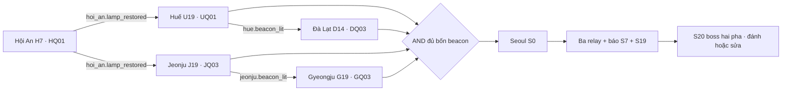

# World Map unlock — Phase 0 source audit

2026-10-18. Chỉ tài liệu. Không đổi gate/runtime; không build hoặc mở Unity trong Phase 0. Source khớp checkpoint WorldReactionsV2 về production inputs đã lưu. Sáu PNG relic + bốn PNG NPC mới chưa import không thuộc snapshot runtime đó.

## Graph thật

**Relic không nằm trên bất kỳ cạnh mở city/đánh boss nào.** Flag `city.hue.unlocked/city.jeonju.unlocked` được HQ01 ghi nhưng quyền Enter thực đọc `unlockFlags`, không đọc hai flag này. H7 vẫn mang tên flag lịch sử `hoi_an.lamp_restored`, không là full-city illumination.

| City/spawn | AND unlock thực | runtimeReady / runtimeNodeIds | Producer | JSON nguồn |
|---|---|---|---|---|
| da_lat/D0 | hue.beacon_lit | true / [] = all | U19 restore_hue / UQ01 | GameplayContent.json:6 /cities/0/unlockFlags |
| gyeongju/G0 | jeonju.beacon_lit | true / [] = all | J19 restore_jeonju / JQ03 | GameplayContent.json:2095 /cities/1/unlockFlags |
| hoi_an/H0 | start | true / null = all | Bắt đầu | GameplayContent.json:3449 /cities/2/unlockFlags |
| hue/U0 | hoi_an.lamp_restored | true / [] = all | H7 restore_lantern / HQ01 | GameplayContent.json:5846 /cities/3/unlockFlags |
| jeonju/J0 | hoi_an.lamp_restored | true / [] = all | H7 restore_lantern / HQ01 | GameplayContent.json:7315 /cities/4/unlockFlags |
| seoul/S0 | hue.beacon_lit AND da_lat.beacon_lit AND jeonju.beacon_lit AND gyeongju.beacon_lit | true / [] = all | U19 + D14 + J19 + G19; không chỉ D21/G20 | GameplayContent.json:8899 /cities/5/unlockFlags |

`GameBootstrap.IsCityUnlocked` dùng `Array.TrueForAll`; `EnterCity` kiểm thêm `runtimeReady`, persist city cũ rồi khôi phục node/visited city đến, spawn nếu không hợp lệ. `WorldMap.Select` cho xem preview nhưng Enter chỉ interactable khi unlocked && ready. `SceneTransition` persist trước đổi scene.

## Node, edge, portal và backtrack

MapDiscoveryManager: runtimeNodeIds giới hạn nội dung (hiện không giới hạn); IsVisible chỉ REVEALED. Stage tăng **liên tục** theo bốn gate của từng city, giữ stage cũ. PREVIEW chỉ vòng mờ nếu author opt-in, không input/actor/chi tiết. Node còn cần requiredFlags; HIDDEN không render/click/path. GameData.FindPath đòi hai đầu Visible và edge.requiredFlags. CityMap xử lý event ở từng node trung gian, không đi xuyên mandatory encounter. Một key gate VISIBLE_LOCKED không đồng nghĩa mọi giao diện/nguồn fragment được cấp.

| Portal | Event requiredFlags | Chặn bổ sung |
|---|---|---|
| da_lat:D21 → seoul | ['da_lat.beacon_lit'] | node stage 4 ['da_lat.beacon_lit']; chỉ mở WorldMap chọn city, Enter vẫn kiểm destination unlockFlags |
| gyeongju:G20 → seoul | ['gyeongju.beacon_lit'] | node stage 4 []; chỉ mở WorldMap chọn city, Enter vẫn kiểm destination unlockFlags |
| hoi_an:H8 → jeonju | ['hoi_an.lamp_restored'] | node stage 4 ['hoi_an.lamp_restored']; chỉ mở WorldMap chọn city, Enter vẫn kiểm destination unlockFlags |
| hoi_an:H20 → hue | ['hoi_an.lamp_restored'] | node stage 4 ['hoi_an.lamp_restored']; chỉ mở WorldMap chọn city, Enter vẫn kiểm destination unlockFlags |
| hue:U20 → da_lat | [] | node stage 4 ['hue.beacon_lit']; chỉ mở WorldMap chọn city, Enter vẫn kiểm destination unlockFlags |
| jeonju:J20 → gyeongju | [] | node stage 4 ['jeonju.beacon_lit']; chỉ mở WorldMap chọn city, Enter vẫn kiểm destination unlockFlags |

D21 có thể mở WorldMap chọn Seoul sau beacon Đà Lạt, **không bypass AND bốn beacon**. U20/J20 có requiredFlags event rỗng, nhưng node/discovery và quyền Enter destination vẫn kiểm gate. Bấm globe về WorldMap không cần portal và không ép rời city khi beacon xong. Không có nhánh code đóng WorldMap vì boss/credits; Back chỉ bị disable khi đang di chuyển/modal, không vì story complete.

## Hai tuyến và bằng chứng

- VN_FIRST: H7 → Huế/U19 → Đà Lạt/D14 → Jeonju/J19 → Gyeongju/G19 → Seoul.
- KOREA_FIRST: H7 → Jeonju/J19 → Gyeongju/G19 bằng nhánh đánh tượng nếu chưa tới Huế → Huế/U19 → Đà Lạt/D14 → Seoul. G12/GQ02 đợi `ancient_seal`, `hue.star_script_known` và `puzzle:puzzle_archive`; không là prerequisite GQ03/G19. Sau Huế quay G12 hoàn tất side quest được. Không sửa điều kiện G7 sửa tượng.

[Historical route evidence](Phase0-20261018/historical-route-evidence.json): Fresh04/Reverse03 earned saves đều có 29 quest complete, boss resolved, ending_seen và sáu city progress. Kết quả E2E hai thứ tự là **bằng chứng lịch sử 17/10**, không phải chạy E2E mới trên binary hiện tại. FullStoryReport ghi lineage/resume và giới hạn. WR V2 mới hơn test H7/Jeonju/restart, không chạy lại sáu chapter.

[48 static BFS checks](Phase0-20261018/post-boss-anchor-reachability.json): đủ 24 anchor ở cả hai earned postgame saves đều city unlocked, REVEALED và có path từ spawn theo source graph. Đây là kiểm tĩnh từ save thật, không phải proof fragment grant/recovery/presentation đã chạy. Chưa có new fragment system nên hai tuyến với 6 relic và old-save retro-grant **NOT_TESTED / NOT_IMPLEMENTED**.

## Khác biệt nguồn cũ và runtime

Nguồn gốc `LBC_Gameplay_6Cities_Detailed_v1/Data/world_progression.json`: sáu unlockFlags khớp runtime. Các resonance mô tả “boss → festival lighting cả sáu” và `hidden_letter_found` là ý đồ cũ, không tự áp vào source mới. Runtime G12 thêm U17 thật; S10 thực yêu cầu stargazer_lens, chưa có OR fallback như một câu trong FULL_STORY_PLAYTEST. Không vá trong Phase 0. Sáu mảnh/di vật chưa tồn tại; ending cũ khác Master mới, xem ONE_ENDING_SIX_RELICS_CANONICAL.

## Nguồn code và dữ liệu

- Assets/_Game/Scripts/Core/GameBootstrap.cs: Reload, Persist, IsCityUnlocked, EnterCity.
- Maps/WorldMap.cs: Select/Enter; Core/SceneTransition.cs: OpenWorld/Load.
- Maps/MapDiscoveryManager.cs: DiscoveryState/Visible/State/Refresh; Core/GameData.cs: Load/EdgeOpen/FindPath.
- Maps/CityMap.cs: TryMove/Travel/OnArrive/Back; UI/GameplayPanels.cs: portal mở WorldMap.
- [Runtime facts có JSON pointer/line](Phase0-20261018/runtime-facts.json), [graph AND/OR](MAP_ARTIFACT_DEPENDENCY_GRAPH.json). Graph là tài liệu, không đặt Resources.

Status: SOURCE_VERIFIED / HISTORICAL_RUNTIME_EVIDENCE; Phase 0 không phát sinh runtime/build PASS mới.

Đối chiếu thêm [8 checks nguồn B](Phase0-20261018/alternative-anchor-reachability.json): J2/G14/S16/J15 đều unlocked/revealed/reachable ở hai earned postgame saves. Không biến kết quả này thành proof fragment đã có hoặc giải quyết timing/migration trước boss.
